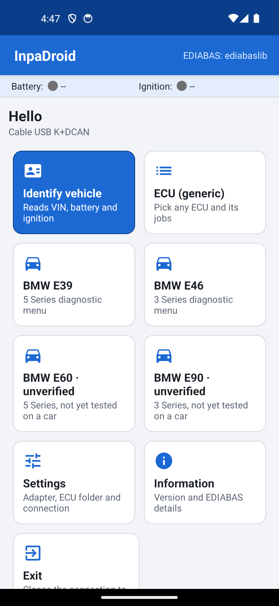
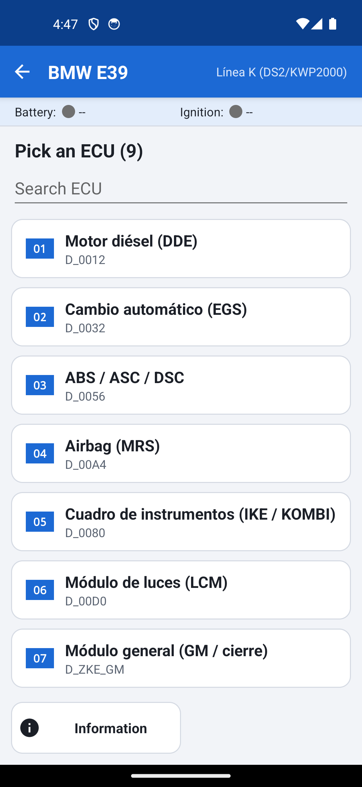

# InpaDroid

> [English](README.md) | **[Español]**

InpaDroid es una app para Android que imita a BMW INPA. Por debajo usa [ediabaslib](https://github.com/uholeschak/ediabaslib), una implementación libre de EDIABAS, así que habla con las centralitas igual que INPA o Tool32: carga un `.prg`, ejecuta sus jobs y enseña los resultados.

La app no trae ningún archivo de BMW. Los `.prg` y `.grp` los pones tú, copiándolos a una carpeta del móvil.

> **Aviso:** INPA y EDIABAS son marcas registradas de BMW AG. Este proyecto no está afiliado ni respaldado por BMW AG de ninguna manera.

---

## Por qué existe

Tenía INPA instalado en un portátil con Windows y lo usaba para hacer diagnosis. Funcionaba bien, pero cada vez que quería mirar algo, aunque solo fuera leer los errores, tenía que sacar el portátil, arrancarlo y conectar el cable. Quería hacerlo con el móvil, que siempre llevo encima, así que decidí pasar el programa a Android con ayuda de la IA. Mantiene las pantallas y las teclas F de INPA, para que quien ya lo conoce pueda usarlo sin aprender nada nuevo.

---

## Qué hace

Esta versión es genérica: no lee los scripts `.ipo` de INPA, sino que monta las pantallas a partir de los jobs que hay dentro de cada `.prg`. Por eso sirve para cualquier centralita que tengas, aunque las pantallas no tengan el diseño específico de cada script de INPA.

Tiene varias pantallas genéricas, más un menú por chasis que se monta a partir de catálogos JSON (ver [Menús por chasis](#menús-por-chasis)):

- **Inicio** — la pantalla de arranque, con tarjetas. Desde aquí se identifica el vehículo, se abre la lista de centralitas, los menús de chasis, el historial y Ajustes. Mientras falte el adaptador o los archivos ECU sale una tarjeta **Empezar** que abre la comprobación de conexión.
- **Selección de centralita** — lista de todos los `.prg` y `.grp` de la carpeta, con buscador. Los grupos (`.grp`) salen arriba y marcados.
- **Pantalla de centralita** — Info, Ident, informe para el cliente, leer y borrar la memoria de errores, Status, Steuern, datos de codificación y una lista de todos los jobs al estilo Tool32.
- **Ajustes** — tipo de adaptador, datos de conexión, carpeta de archivos e importación de archivos ECU desde el móvil.
- **Comprobación de conexión** — primer uso guiado: revisa el adaptador y los archivos ECU paso a paso y permite importar los archivos desde ahí.
- **Historial** — lecturas de errores guardadas en el móvil, con comparación entre dos de ellas.

Cada pantalla ofrece sus opciones como tarjetas táctiles con icono; las destructivas (borrar errores, activaciones) van en rojo y piden confirmación. Arriba hay dos indicadores, Batería y Encendido, que se actualizan cada dos segundos más o menos. La app sigue el tema claro u oscuro del sistema, funciona en apaisado (las tarjetas se desplazan junto con los resultados) y tiene interfaz en español, inglés, alemán y portugués. Los catálogos de chasis solo existen en español e inglés, así que en alemán o portugués salen en inglés. Las tarjetas y la gráfica en vivo llevan descripciones para TalkBack, y el menú de inicio pasa a una columna con letra del sistema muy grande.

En la cabecera de cada resultado hay un enlace **Compartir CSV**. Guarda los resultados que ves en pantalla como un fichero `.csv` y abre el menú de compartir de Android (correo, mensajería, Drive…).

Otras funciones:

- **Escaneo rápido** — en un menú de chasis, lee la memoria de errores de todas las centralitas del catálogo una tras otra y muestra un resumen (centralitas con errores y centralitas sin leer). El resumen se puede compartir como CSV.
- **Errores legibles** — los errores de conexión (sin respuesta de la centralita, adaptador perdido, permiso USB, SGBD o job no encontrado, tiempo agotado...) salen como una frase clara. Los que no reconoce los muestra tal cual.
- **Fichas de error** — cada fallo de `FS_LESEN` sale como una ficha con su código, descripción, estado (presente ahora o almacenado, solo si la centralita lo informa), contador de frecuencia y condiciones de funcionamiento.
- **Informe para el cliente** — **F3** dentro de una centralita lee los errores y los comparte como archivo HTML (fecha, chasis, centralita, SGBD, fallos) que puedes enviar o imprimir.
- **Historial y comparación** — cada lectura de errores se guarda en el móvil, y también la copia automática que se hace antes de borrar. Puedes comparar dos lecturas.
- **Monitor en vivo** — la gráfica (F8 en una centralita de chasis) deja elegir qué valores dibujar y grabarlos en un archivo CSV.
- **Datos de codificación** — lee, guarda y compara la codificación de una centralita (ver [Datos de codificación](#datos-de-codificación)).
- **Serie F (F30, F10)** — catálogos esqueleto por ENET, sin verificar (ver [Menús por chasis](#menús-por-chasis)).

<p>
  
  
</p>

---

## Qué necesitas

**Hardware:**
- Un móvil o tablet Android.
- Un cable o adaptador de diagnóstico. Valen estos:
  - **Cable K+DCAN USB** (serie E). Tiene que llevar chip FTDI y necesitas un adaptador OTG para enchufarlo al móvil. Los clones con otros chips (CH340, por ejemplo) no funcionan.
  - **Cable ENET** (serie F/G). Se conecta por WiFi si tienes un adaptador ENET WiFi, o con un adaptador USB-Ethernet en el móvil.
  - **Adaptador ELM327** por Bluetooth o WiFi. Es la opción más limitada: con centralitas D-CAN puede servir, pero con coches BMW que usan DS2 o línea K casi nada funciona. Si tu coche es de la serie E, usa el cable K+DCAN.

**Software:**
- Tus archivos `.prg` y `.grp` de EDIABAS, los mismos que tienes en `C:\EDIABAS\Ecu` en el PC.

---

## Compilar la APK

El entorno de compilación requiere:
- .NET 10 con el workload de Android (`~/.dotnet`)
- JDK 21 (`/usr/lib/jvm/java-21-openjdk-amd64`)
- Android SDK (`~/Android/Sdk`)

Desde la carpeta `InpaDroid` ejecuta:

```sh
./build.sh
```

La APK queda en `out/InpaDroid.apk`. `build.sh` la firma con la clave de depuración de Android y crea `~/.android/debug.keystore` si todavía no existe. Las variables de entorno `JAVA_HOME`, `ANDROID_HOME` y `DOTNET_ROOT` sustituyen las rutas de arriba.

Las pruebas unitarias (lectura de catálogos y modelos de datos) corren en .NET normal, sin Android ni móvil:

```sh
dotnet test tests/InpaDroid.Tests
```

GitHub Actions pasa esas mismas pruebas, comprueba que los JSON de catálogo son válidos y compila la app en cada push y pull request (`.github/workflows/ci.yml`). Al subir una etiqueta `v*` se compila una APK firmada y se publica como GitHub Release; los detalles están en [docs/RELEASING.md](docs/RELEASING.md).

Para instalarla en el móvil tienes dos opciones:

1. Copia `InpaDroid.apk` al móvil, ábrela desde el gestor de archivos y acepta la instalación. Android pedirá permitir apps de origen desconocido para esa aplicación; dale permiso y vuelve atrás.
2. Con depuración USB activada en el móvil:

   ```sh
   adb install -r out/InpaDroid.apk
   ```

---

## Copiar los archivos de BMW al móvil

Por defecto la app busca los archivos en su propia carpeta del almacenamiento interno:

```
Almacenamiento interno/
└── Android/
    └── data/
        └── com.inpadroid.app/
            └── files/
                └── Ecu/
                    ├── D_MOTOR.grp
                    ├── MS450DS0.prg
                    ├── UTILITY.prg
                    └── ...
```

La ruta completa suele ser `/storage/emulated/0/Android/data/com.inpadroid.app/files/Ecu/`. La carpeta `com.inpadroid.app` aparece después de abrir la app por primera vez.

**Pasos:**
1. Abre InpaDroid una vez y ciérrala.
2. Conecta el móvil al PC por USB y elige "Transferencia de archivos".
3. En el PC, entra en el móvil y ve a `Android/data/com.inpadroid.app/files/`.
4. Copia ahí dentro el contenido de tu `C:\EDIABAS\Ecu` (los `.prg` y `.grp` sueltos dentro de `Ecu`, sin subcarpetas).

En Android 11 y posteriores muchos gestores de archivos del propio móvil no dejan entrar en `Android/data`. Desde el PC por cable normalmente sí se puede. Si no te deja, usa otra carpeta y cámbiala en Ajustes.

**Importar desde el móvil:** si los archivos ya están en el móvil (descargados, en la tarjeta de memoria, en Drive) no necesitas el PC. En Ajustes (y en la comprobación de conexión) usa el botón de importar y elige en el selector de documentos de Android los `.prg`/`.grp` o un `.zip` que los contenga. Solo se copian `.prg` y `.grp` a la carpeta ECU (las subcarpetas de un ZIP se aplanan) y se rechazan los archivos comprimidos de tamaño desmedido.

**Qué archivos importan:**
- `.prg` y `.grp` — cópialos todos.
- `UTILITY.prg` — conviene que esté; los indicadores de batería y encendido salen de él.
- `.ipo` y `.ips` (los scripts de INPA, en `INPA\SGDAT`) — esta versión no los usa. No pasa nada si los copias, pero los ignora.
- `.exe`, `.dll` y demás archivos de Windows — no sirven en Android, no hace falta copiarlos.

---

## Configurar el adaptador

Todo se hace en Ajustes. Elige el tipo de adaptador y rellena lo que corresponda.

### Cable K+DCAN USB

No hay nada más que configurar. Conecta el cable al móvil con el adaptador OTG y al coche. La primera vez Android pregunta si InpaDroid puede usar el dispositivo USB; acepta (y marca que lo recuerde, si te lo ofrece).

### ENET

En host ENET deja `auto` para que la app busque el coche en la red. Si no lo encuentra, escribe la IP del coche o del adaptador ENET WiFi. Con WiFi, conecta antes el móvil a la red del adaptador; con USB-Ethernet, enchufa el adaptador al móvil y el cable al coche.

### ELM327 Bluetooth

Empareja primero el ELM327 desde los ajustes de Bluetooth de Android (el PIN suele ser 1234 o 0000). Después, en Ajustes de InpaDroid, elige el adaptador de la lista de dispositivos emparejados. En Android 12 o posterior la app pide permiso de "Dispositivos cercanos" para usar Bluetooth; hay que dárselo.

### ELM327 WiFi

Conecta el móvil a la red WiFi del ELM327 y escribe su dirección en host ELM WiFi. Por defecto es `192.168.0.10:35000`, que es la de la mayoría de estos adaptadores. Si el tuyo usa otra, la verás en sus instrucciones.

---

## Uso paso a paso

0. Opcional: pulsa **Empezar** en la pantalla de inicio (sale mientras falte el adaptador o los archivos ECU) para una comprobación guiada del adaptador y los archivos.
1. Conecta el adaptador al coche y pon el contacto (posición 2, motor apagado).
2. Abre InpaDroid. En la cabecera, **Batería** se pone en verde cuando la app lee tensión en el conector, y **Encendido** cuando detecta el contacto puesto. Se refrescan cada dos segundos. Si se quedan en gris, revisa el cable, el contacto y que tengas `UTILITY.prg` en la carpeta.
3. La pantalla de inicio son tarjetas: Identificar vehículo (necesita `UTILITY` o `CAS`), Selección de centralita, una tarjeta por chasis (E39, E46, E60, E90, F30, F10), Historial, Ajustes, Información y Salir. E60, E90, F30 y F10 están sin verificar.

4. Abre **Selección de centralita** y busca la centralita. Puedes escribir parte del nombre en el buscador (por ejemplo `MOTOR` o `EGS`). Si eliges un `.grp`, la app averigua qué `.prg` concreto lleva tu coche, igual que hace INPA.
5. Dentro de la centralita, las teclas son las de un script INPA estándar:

   | Tecla | Función | Job que ejecuta |
   |-------|---------|-----------------|
   | F1 | Info | `INFO` |
   | F2 | Ident | `IDENT` |
   | F3 | Informe para el cliente (lee errores y comparte un HTML) | `FS_LESEN` |
   | F4 | Leer memoria de errores | `FS_LESEN` |
   | Shift+F4 | Borrar memoria de errores (pide confirmación; antes guarda una copia de los errores en el historial) | `FS_LOESCHEN` |
   | F5 | Status (lectura continua) | jobs `STATUS_*` |
   | F6 | Steuern (activar componentes) | jobs `STEUERN_*` |
   | F7 | Todos los jobs (Tool32) | — |
   | F8 | Datos de codificación (leer, guardar, comparar; nunca escribe) | ver [Datos de codificación](#datos-de-codificación) |
   | F9 | Copiar resultados al portapapeles | — |
   | F10 | Volver | — |

Status repite el job elegido cada segundo. Para en cuanto pulsas cualquier tecla.

Steuern muestra un aviso y pide confirmación antes de enviar el job. La confirmación enseña el SGBD, el job y sus argumentos, para que veas exactamente qué se va a enviar, y destaca un aviso si la tensión de la batería de la cabecera está por debajo de 11,5 V o no se pudo leer (no bloquea).

F7 funciona como Tool32: eliges cualquier job, escribes los argumentos separados por `;` y lo ejecutas. Los jobs que solo leen (`STATUS_*`, `IDENT`, `FS_LESEN`, `INFO`...) se ejecutan directamente; el resto pide confirmación con el detalle SGBD/JOB/ARGS. La lista de jobs se lee directamente del `.prg`, así que funciona sin coche conectado.

---

## Menús por chasis

Las tarjetas de chasis de la pantalla de inicio abren el menú del E39, E46, E60, E90, F30 o F10. Cada menú muestra las centralitas de un catálogo incorporado (`src/InpaDroid/Ui/Chassis/<id>_catalog.json`). Los del E39 y el E46 tienen jobs y nombres de resultado comprobados. Los del E60, E90, F30 y F10 son esqueletos cortos marcados como sin verificar hasta que alguien los pruebe en un coche. Los de F30 y F10 solo listan centralitas (sin páginas de status ni activaciones) y esperan una conexión ENET (HSFZ); K+DCAN y ELM327 no sirven en esos coches.

En el menú del chasis, **F2 Escaneo rápido** lee la memoria de errores de todas las centralitas del catálogo y muestra un resumen, y **F1** enseña la información del chasis.

Dentro de una centralita de un menú de chasis:

| Tecla | Función |
|-------|---------|
| F1 | Info: SGBD, variante identificada, páginas de status y acciones del catálogo |
| F2 | Ident |
| F3 | Informe para el cliente: lee los errores y los comparte como archivo HTML |
| F4 / Shift+F4 | Leer / borrar la memoria de errores (borrar pide confirmación y antes guarda una copia de los errores en el historial) |
| F5 | Páginas de status con valores en directo, cada segundo |
| F6 | Steuern: tests de actuadores del catálogo, cada uno con aviso de seguridad y confirmación |
| F7 | Todos los jobs del `.prg` (abre la pantalla genérica de centralita) |
| F8 | Gráfica en vivo: repite el primer job de una página de status unas dos veces por segundo y dibuja sus valores numéricos, con botones Pausar y Borrar, selector de valores y grabación a un archivo CSV |
| F9 | Datos de codificación: leer, guardar y comparar (ver [Datos de codificación](#datos-de-codificación)) |
| F10 | Volver |

---

## Datos de codificación

Desde una centralita (F8 en la pantalla genérica, F9 en un menú de chasis) puedes leer sus datos de codificación, guardar una instantánea en el móvil, compartirla como CSV y compararla con una guardada. Esta pantalla **nunca escribe codificación**: la escritura de codificación al estilo NCS no está implementada a propósito. Si de verdad necesitas enviar un job que cambie la codificación, usa la lista libre de jobs (F7), que pide confirmación mostrando SGBD, JOB y ARGS.

---

## BMW E39

Esta parte es para el E39 diésel: 520d con motor M47, o 525d y 530d con M57.

### Cable

En el E39 solo sirve el cable K+DCAN USB con chip FTDI. El coche va por línea K (DS2/KWP2000); con eso ni el ELM327 ni el ENET funcionan. El cable lleva un interruptor (o un puente) entre los pines 7 y 8 del conector OBD: tiene que estar en la posición **old** (pines unidos). Si lo dejas en la posición de los coches nuevos, no conecta.

Al móvil se enchufa con un adaptador OTG.

Los E39 fabricados antes de septiembre de 2000 pueden no tener el conector OBD de 16 pines conectado a todas las centralitas. En esos coches a veces hace falta el adaptador al conector redondo de 20 pines que hay bajo el capó.

Mientras diagnosticas, el contacto tiene que estar puesto (posición 2) con el motor parado. Si vas a estar mucho rato, conecta un cargador de batería: con el contacto puesto la batería baja rápido, y una tensión baja da errores raros en las centralitas.

### Archivos

Del paquete `daten E39 v70` solo hace falta la carpeta `ecu`. Copia todo su contenido (todos los `.prg` y `.grp`, sueltos, sin subcarpetas) en la carpeta `Ecu` de la app. Son unos 700 `.prg` y 241 `.grp`.

El resto de carpetas (`sgdat`, `daten`, `data`, `work`, `cfgdat`) no hace falta en el móvil.

### Menú Vehículo E39

En la pantalla de inicio, la tarjeta del E39 abre el menú BMW E39. Sale la lista de centralitas del E39, con la del motor diésel (DDE) la primera. Las teclas dentro de cada centralita son las de [Menús por chasis](#menús-por-chasis).

### Primera prueba en el coche

1. Instala la APK en el móvil.
2. Copia el contenido de `ecu` a la carpeta `Ecu` de la app y comprueba en Ajustes que detecta los `.prg` y `.grp`.
3. Pon el interruptor del cable en **old** y conéctalo al coche y al móvil con el OTG.
4. En Ajustes, elige "Cable USB K+DCAN (FTDI)" y pulsa **Detectar cable**. Cuando Android pregunte, acepta el permiso USB.
5. Pon el contacto (posición 2).
6. Vuelve a la pantalla de inicio y espera a que Batería y Encendido se pongan en verde.
7. Abre la tarjeta BMW E39, entra en DDE y pulsa Ident.

Si Ident devuelve datos de la centralita, la conexión funciona y puedes seguir con la memoria de errores y las páginas de status.

Si algo falla, la app escribe el error en rojo, con una explicación clara cuando reconoce la causa. Para pedir ayuda, copia ese texto tal cual o haz una captura de pantalla, y di en qué paso te quedaste, qué centralita estabas abriendo y si Batería y Encendido estaban en verde.

---

## Problemas frecuentes

**No conecta**
Comprueba que el contacto está puesto y que el tipo de adaptador de Ajustes es el que tienes enchufado. Con el cable USB, mira que sea FTDI, que el adaptador OTG funcione y que aceptaste el permiso USB. Con ENET, que el móvil esté en la red correcta; si `auto` no lo encuentra, pon la IP a mano. Con ELM327, recuerda que en coches con DS2 o línea K no funciona bien. El error sale escrito en pantalla; si no lo entiendes, apúntalo tal cual.

**No aparecen las centralitas**
Ve a Ajustes y mira cuántos `.prg`/`.grp` ha encontrado. También puedes importarlos desde el móvil con el botón de importar. Si son cero, los archivos no están en la carpeta configurada o están dentro de una subcarpeta. Tienen que estar sueltos dentro de `Ecu`.

**El job no existe**
No todas las centralitas tienen `INFO`, `IDENT`, `FS_LESEN` y demás, y a veces se llaman distinto. Entra en F7 Jobs para ver qué jobs tiene de verdad ese `.prg`. Si estás usando un `.grp` y falla, prueba a abrir directamente el `.prg` de tu centralita.

**Permisos de Bluetooth o USB denegados**
Si denegaste un permiso, la app no puede volver a pedirlo sola. Ve a Ajustes de Android → Aplicaciones → InpaDroid → Permisos y activa "Dispositivos cercanos" para Bluetooth. Para USB, desenchufa y vuelve a enchufar el cable: Android vuelve a preguntar.

---

## Avisos

Las funciones de Steuern activan componentes reales del coche: actuadores, válvulas, relés. Un argumento equivocado o un job enviado en mal momento puede dejar una centralita en un estado indefinido o causar daños. Úsalas solo si sabes exactamente qué hace el job, con el coche parado y la batería en buen estado. Lo mismo vale para cualquier job lanzado desde F7.

La app ayuda, pero no te protege del todo: la confirmación muestra SGBD, JOB y ARGS y avisa si la batería está por debajo de 11,5 V o no se ha leído, y antes de borrar errores guarda una copia en el historial. Los catálogos de la serie F (F30, F10) y los del E60 y E90 están sin verificar y no se han probado en un coche. La escritura de codificación no está implementada a propósito.

ediabaslib tiene licencia GPLv3. Si distribuyes la APK a otras personas, tienes que publicar también el código fuente de la app.

Los archivos de BMW (`.prg`, `.grp`, `.ipo`, INPA, EDIABAS) son propiedad de BMW AG. No se incluyen en la app ni en este repositorio y no deben redistribuirse. La carpeta `datos_bmw/` está excluida del control de versiones por ese motivo.

---

## Ampliar los catálogos de chasis

Los catálogos incorporados son archivos JSON metidos en la app: nueve centralitas del E39, siete del E46 y unas listas cortas sin verificar para el E60, el E90, el F30 (tres centralitas) y el F10 (dos). Puedes sustituir cualquiera sin recompilar dejando un archivo con el mismo nombre (`e39_catalog.json`, `e46_catalog.json`, `e60_catalog.json`, `e90_catalog.json`, `f30_catalog.json` o `f10_catalog.json`) en tu carpeta ECU. La app lo lee al arrancar; si tiene errores, se queda con el incorporado.

El formato está explicado en [CONTRIBUTING.md](CONTRIBUTING.md#formato-del-catálogo), y [`src/InpaDroid/Ui/Chassis/e39_catalog.json`](src/InpaDroid/Ui/Chassis/e39_catalog.json) es un ejemplo completo.

---

## Cómo contribuir

Ver [CONTRIBUTING.md](CONTRIBUTING.md).

---

## Licencia

GPLv3 — ver [LICENSE](LICENSE). Cualquier dependencia que añadas debe ser compatible con la GPL.

---

## Créditos

- [ediabaslib](https://github.com/uholeschak/ediabaslib) de Ulrich Holeschak — el motor EDIABAS que hace posible todo esto.
- Partes de este proyecto se desarrollaron con la ayuda de [Claude Code](https://claude.com/claude-code), la herramienta de programación IA de Anthropic, utilizada de forma responsable como asistente de desarrollo — generación de código, revisión y refactorización bajo supervisión humana.
