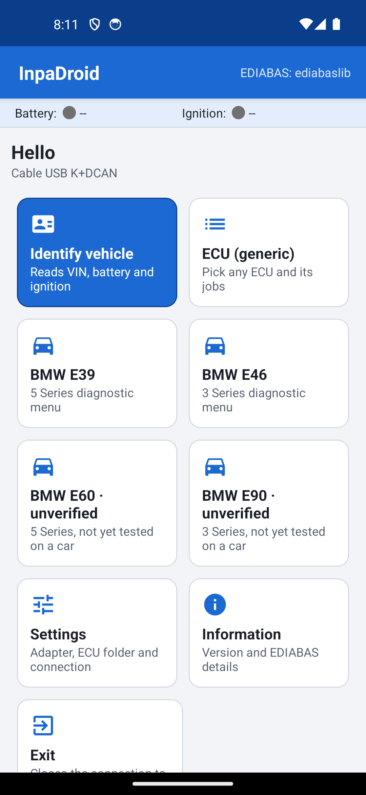
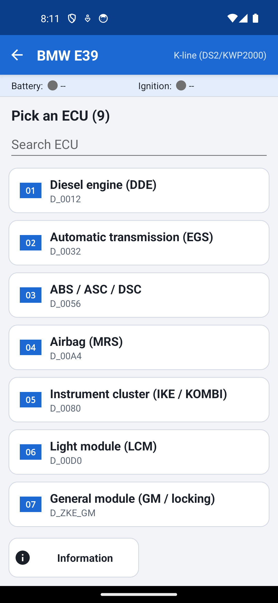

# InpaDroid

> **[English]** | [Español](README.es.md)

Android app that mimics BMW INPA using [ediabaslib](https://github.com/uholeschak/ediabaslib) — a free EDIABAS implementation — as its diagnostic engine. It talks to ECUs the same way INPA or Tool32 does: load a `.prg`, run its jobs, read the results.

The app ships with no BMW files. You supply your own `.prg` and `.grp`, copied from your EDIABAS installation. You can copy them over from a PC or import them from the phone in Settings.

> **Disclaimer:** INPA and EDIABAS are trademarks of BMW AG. This project is not affiliated with or endorsed by BMW AG in any way.

---

## What it does

This version is generic: it does not parse `.ipo` scripts; instead, it builds screens from the jobs inside each `.prg`. This means it works with any ECU you have files for, even if the screens do not look exactly like an INPA script.

There are generic screens plus per-chassis vehicle menus built from JSON catalogs (see [Chassis menus](#chassis-menus)):

- **Home** — startup screen with cards. Identifies the vehicle, opens the ECU list, the chassis menus, the history and Settings. While the adapter or the ECU files are missing it shows a **Get started** card that opens the connection check.
- **ECU selection** — lists all `.prg` and `.grp` files in the configured folder, with a search box. Group files (`.grp`) appear first and are labeled.
- **ECU screen** — Info, Ident, customer report, read and clear fault memory, Status, Steuern, coding data and a full job list (Tool32 style).
- **Settings** — adapter type, connection details, ECU folder and import of ECU files from the phone.
- **Connection check** — guided first run: checks the adapter and the ECU files step by step and lets you import the files from there.
- **History** — fault reads saved on the phone, with a comparison between two of them.

Each screen offers its options as touch cards with an icon; destructive ones (clear faults, actuator tests) are red and ask for confirmation. The header shows a Battery and Ignition indicator that refreshes roughly every two seconds. The app follows the system light/dark theme, works in landscape (the cards scroll together with the results) and has Spanish, English, German and Portuguese interfaces. The chassis catalogs only exist in Spanish and English, so in German or Portuguese they appear in English. Cards and the live chart carry TalkBack descriptions, and the home menu switches to one column with very large system text.

Every job result has a **Share CSV** link in its header. It saves the displayed results as a `.csv` file and opens Android's share sheet (mail, messaging, Drive…).

Other features:

- **Quick scan** — in a chassis menu, reads the fault memory of every ECU in the catalog one after another and shows a summary (ECUs with faults, ECUs not read). The summary can be shared as CSV.
- **Readable errors** — connection errors (no ECU response, adapter lost, USB permission, SGBD or job not found, timeout...) are shown as a plain sentence. Unrecognised errors are shown as the raw text.
- **Fault cards** — each fault from `FS_LESEN` is shown as a card with its code, description, state (present now or stored, only when the ECU reports it), frequency counter and operating conditions.
- **Customer report** — **F3** inside an ECU reads the faults and shares them as an HTML file (date, chassis, ECU, SGBD, faults) you can send or print.
- **History and compare** — every fault read is saved on the phone, and so is the automatic backup made before clearing. You can compare two reads.
- **Live monitor** — the chart (F8 in a chassis ECU) lets you choose which values to plot and record them to a CSV file.
- **Coding data** — reads, saves and compares the coding data of an ECU (see [Coding data](#coding-data)).
- **F-series (F30, F10)** — skeleton catalogs over ENET, unverified (see [Chassis menus](#chassis-menus)).

<p>
  
  
</p>

---

## Requirements

**Hardware:**
- Android phone or tablet
- A diagnostic adapter. Supported types:
  - **K+DCAN USB cable** (E-series cars). Must have an FTDI chip. Requires a USB OTG adapter to plug into the phone. Clones with CH340 or similar chips will not work.
  - **ENET cable** (F/G-series). Connects over Wi-Fi (with a Wi-Fi ENET adapter) or with a USB-Ethernet dongle on the phone.
  - **ELM327 Bluetooth or Wi-Fi**. Most limited option: works with D-CAN cars (roughly 2007 onward), but not with older BMW DS2/K-line cars. If your car is E-series, use the K+DCAN cable.

**Software:**
- Your EDIABAS `.prg` and `.grp` files (the same ones in `C:\EDIABAS\Ecu` on your PC).

---

## Building the APK

The build environment requires:
- .NET 10 with the Android workload (`~/.dotnet`)
- JDK 21 (`/usr/lib/jvm/java-21-openjdk-amd64`)
- Android SDK (`~/Android/Sdk`)

From the `InpaDroid` folder:

```sh
./build.sh
```

The APK lands at `out/InpaDroid.apk`. `build.sh` signs it with the Android debug key and creates `~/.android/debug.keystore` if it does not exist yet; the environment variables `JAVA_HOME`, `ANDROID_HOME` and `DOTNET_ROOT` override the default paths above.

The unit tests (catalog parsing and data models) run on plain .NET, without Android or a device:

```sh
dotnet test tests/InpaDroid.Tests
```

GitHub Actions runs the same tests, a JSON check of the catalogs and an Android build on every push and pull request (`.github/workflows/ci.yml`). Pushing a `v*` tag builds a signed APK and publishes it as a GitHub Release; see [docs/RELEASING.md](docs/RELEASING.md).

---

## Installing ECU files on the phone

The app looks for ECU files in its own external storage folder by default:

```
Internal storage/
└── Android/
    └── data/
        └── com.inpadroid.app/
            └── files/
                └── Ecu/
                    ├── D_MOTOR.grp
                    ├── MS450DS0.prg
                    ├── UTILITY.prg
                    └── ...
```

The full path is usually `/storage/emulated/0/Android/data/com.inpadroid.app/files/Ecu/`. The `com.inpadroid.app` folder appears the first time you launch the app.

**Steps:**
1. Open InpaDroid once and close it.
2. Connect the phone to your PC with USB, choose "File transfer" on the phone.
3. On the PC, navigate to `Android/data/com.inpadroid.app/files/`.
4. Copy the contents of your `C:\EDIABAS\Ecu` into the `Ecu` folder — `.prg` and `.grp` files loose, no subfolders.

On Android 11 and later, some phone file managers block access to `Android/data`. Transferring from a PC over USB usually works. If not, use a different folder and change the ECU path in Settings.

**Import from the phone:** if the files are already on the phone (downloaded, on a memory card, in Drive), you do not need a PC. In Settings (and in the connection check) use the import button and pick `.prg`/`.grp` files or a `.zip` with them in Android's document picker. Only `.prg` and `.grp` are copied into the ECU folder (subfolders inside a ZIP are flattened) and oversized archives are refused.

**Which files matter:**
- `.prg` and `.grp` — copy all of them.
- `UTILITY.prg` — keep this one; the Battery and Ignition indicators read from it.
- `.ipo` and `.ips` (INPA scripts in `INPA\SGDAT`) — not used yet; copy them if you want but they will be ignored.
- Windows `.exe`, `.dll`, etc. — skip, not useful on Android.

---

## Configuring the adapter

Everything is in Settings. Select your adapter type and fill in the relevant fields.

### K+DCAN USB cable

No extra configuration. Plug the cable into the phone with an OTG adapter and into the car. The first time you connect, Android asks for USB permission; accept it (and tick "Remember" if offered).

### ENET

Leave the ENET host as `auto` to let the app find the car on the network. If that fails, enter the car's IP or the ENET Wi-Fi adapter's IP. For Wi-Fi, connect the phone to the adapter's network first. For USB-Ethernet, plug the adapter into the phone and the cable into the car.

### ELM327 Bluetooth

Pair the ELM327 from Android's Bluetooth settings first (PIN is usually `1234` or `0000`). Then in InpaDroid Settings, pick it from the paired device list. On Android 12 and later the app requests "Nearby devices" permission; allow it.

### ELM327 Wi-Fi

Connect the phone to the ELM327's Wi-Fi network, then set the host in ELM Wi-Fi host. The default is `192.168.0.10:35000`, which covers most of these adapters. Check your adapter's manual if yours is different.

---

## Step-by-step first use

0. Optional: tap **Get started** on the home screen (shown while the adapter or the ECU files are missing) for a guided check of the adapter and the files.
1. Connect the adapter to the car and turn on the ignition (key position 2, engine off).
2. Open InpaDroid. In the header, **Battery** turns green when the app reads voltage at the connector; **Ignition** turns green when it detects the ignition. Both refresh every couple of seconds. If they stay grey, check the cable, the ignition position, and that `UTILITY.prg` is in the ECU folder.
3. The home screen is a set of cards: Identify vehicle (needs `UTILITY` or `CAS`), ECU selection, one card per chassis (E39, E46, E60, E90, F30, F10), History, Settings, Information and Exit. E60, E90, F30 and F10 are unverified.

4. Open **ECU selection** and search for an ECU by partial name (e.g. `MOTOR` or `EGS`). Selecting a `.grp` makes the app identify which `.prg` your car actually has, the same way INPA does.
5. Inside an ECU screen:

   | Key | Function | Job |
   |-----|----------|-----|
   | F1 | Info | `INFO` |
   | F2 | Ident | `IDENT` |
   | F3 | Customer report (reads faults, shares an HTML file) | `FS_LESEN` |
   | F4 | Read fault memory | `FS_LESEN` |
   | Shift+F4 | Clear fault memory (asks confirmation; saves a backup of the faults in the history first) | `FS_LOESCHEN` |
   | F5 | Status (live polling) | `STATUS_*` jobs |
   | F6 | Steuern (actuator tests) | `STEUERN_*` jobs |
   | F7 | All jobs (Tool32 style) | — |
   | F8 | Coding data (read, save, compare; never writes) | see [Coding data](#coding-data) |
   | F9 | Copy results to the clipboard | — |
   | F10 | Back | — |

Status polls the selected job roughly once per second. It stops when you press any key.

Steuern shows a warning and asks for confirmation before sending the job. The confirmation lists the SGBD, the job and its arguments, so you see exactly what will be sent, and shows a highlighted notice when the battery voltage in the header is below 11.5 V or could not be read (it does not block).

F7 lets you pick any job, enter arguments separated by `;`, and run it. Jobs that only read (`STATUS_*`, `IDENT`, `FS_LESEN`, `INFO`...) run directly; anything else asks for confirmation with the SGBD/JOB/ARGS detail. The job list is read from the `.prg` itself, so it works without a car connected.

---

## Chassis menus

The chassis cards on the home screen open a vehicle menu for the E39, E46, E60, E90, F30 or F10. Each menu lists the ECUs of a built-in catalog (`src/InpaDroid/Ui/Chassis/<id>_catalog.json`). The E39 and E46 catalogs hold checked jobs and result names. The E60, E90, F30 and F10 ones are short skeletons marked as unverified until someone tests them on a car. The F30 and F10 catalogs only list ECUs (no status pages or actuator tests) and expect an ENET connection (HSFZ); K+DCAN and ELM327 do not work on those cars.

In the chassis menu, **F2 Quick scan** reads the fault memory of all the ECUs in the catalog and shows a summary, and **F1** shows the chassis information.

Inside an ECU of a chassis menu:

| Key | Function |
|-----|----------|
| F1 | Info: SGBD, identified variant, status pages and actions in the catalog |
| F2 | Ident |
| F3 | Customer report: reads the faults and shares them as an HTML file |
| F4 / Shift+F4 | Read / clear fault memory (clear asks for confirmation and saves a backup of the faults in the history first) |
| F5 | Status pages with live values, refreshed every second |
| F6 | Steuern: catalog actuator tests, each with a safety warning and a confirmation |
| F7 | All jobs in the `.prg` (opens the generic ECU screen) |
| F8 | Live chart: repeats the first job of a status page about twice per second and plots its numeric values, with Pause and Clear buttons, a value picker and recording to a CSV file |
| F9 | Coding data: read, save and compare (see [Coding data](#coding-data)) |
| F10 | Back |

---

## Coding data

From an ECU (F8 in the generic screen, F9 in a chassis menu) you can read its coding data, save a snapshot on the phone, share it as CSV and compare it with a saved one. This screen **never writes coding**: NCS-style coding writes are intentionally not implemented. If you really need to send a job that changes coding, use the free job list (F7), which asks for confirmation showing the SGBD, JOB and ARGS.

---

## BMW E39

This section covers the E39 diesel: 520d (M47 engine) and 525d/530d (M57 engine).

### Cable

Only the K+DCAN USB cable with an FTDI chip works on the E39. The car uses K-line (DS2/KWP2000); neither ENET nor ELM327 will communicate with it. The cable has a switch (or solder bridge) between pins 7 and 8 of the OBD connector — it must be in the **old** position (pins bridged). In the new position the car will not respond.

Use an OTG adapter to connect to the phone.

E39s built before September 2000 may have the 16-pin OBD connector wired to fewer ECUs. Those cars sometimes need the adapter to the round 20-pin connector under the bonnet.

Keep the ignition on (key position 2) and the engine off while diagnosing. If you will be connected for a long time, use a battery charger — low voltage causes spurious ECU errors.

### ECU files

From the `daten E39 v70` package you only need the `ecu` folder. Copy all its contents (`.prg` and `.grp`, loose, no subfolders) into the `Ecu` folder of the app. Roughly 700 `.prg` and 241 `.grp`.

The other folders (`sgdat`, `daten`, `data`, `work`, `cfgdat`) are not needed on the phone.

### E39 menu

Tap the E39 card on the home screen to open the E39 vehicle menu. It shows the list of catalogued ECUs, with the diesel engine control unit (DDE) at the top. The keys inside each ECU are the ones in [Chassis menus](#chassis-menus).

### First test

1. Install the APK on the phone.
2. Copy the contents of `ecu` to the `Ecu` folder and check in Settings that it detects the `.prg` and `.grp` files.
3. Set the cable switch to the **old** position. Connect it to the car and to the phone with an OTG adapter.
4. In Settings, select **K+DCAN USB cable (FTDI)** and tap **Detect cable**. When Android asks for USB permission, allow it.
5. Turn on the ignition (position 2, engine off).
6. Go back to the home screen and wait for Battery and Ignition to turn green.
7. Open the BMW E39 card, enter DDE, and press **Ident**.

If Ident returns ECU data, the connection is working and you can continue with fault memory and status pages.

If something fails, the app shows the error in red, with a plain explanation when it recognises the cause. To report an issue, copy that error text exactly or take a screenshot, and note which step failed, which ECU you were opening, and whether Battery and Ignition were green.

---

## Troubleshooting

**No connection**
Check the ignition is on and the adapter type in Settings matches what you have plugged in. For USB, verify the chip is FTDI, that the OTG adapter works (test with a USB drive), and that you accepted the USB permission. For ENET, make sure the phone is on the right network; enter the IP manually if `auto` does not work. For ELM327, remember that DS2/K-line cars are not supported. The error text on screen is the starting point for debugging.

**No ECUs listed**
Go to Settings and check how many `.prg`/`.grp` files it found. You can also import them from the phone with the import button. If zero, the files are not in the configured folder or they are inside a subfolder. They must be loose inside `Ecu`.

**Job not found**
Not every ECU has `INFO`, `IDENT`, `FS_LESEN`, etc., and some use different names. Use F7 Jobs to see what jobs the `.prg` actually has. If you are using a `.grp` and it fails, try opening the specific `.prg` for your ECU directly.

**Bluetooth or USB permission denied**
If you denied a permission, the app cannot request it again on its own. Go to Android Settings → Apps → InpaDroid → Permissions and enable "Nearby devices" for Bluetooth. For USB, unplug and replug the cable; Android will ask again.

---

## Warnings

Steuern functions activate real vehicle components — actuators, valves, relays. A wrong argument or a job sent at the wrong time can leave an ECU in an undefined state or cause damage. Only use them if you know exactly what the job does, with the car stationary and the battery in good condition. The same applies to any job run from F7.

The app helps but does not protect you: the confirmation shows the SGBD, JOB and ARGS and warns when the battery is under 11.5 V or unread, and clearing faults saves a backup in the history first. The F-series (F30, F10) and E60/E90 catalogs are unverified and have not been tested on a car. Coding writes are not implemented on purpose.

ediabaslib is licensed under GPLv3. If you distribute the APK to other people, you must also publish the app's source code.

BMW files (`.prg`, `.grp`, `.ipo`, INPA, EDIABAS) are the property of BMW AG. They are not included in the app or this repository and must not be redistributed. The `datos_bmw/` folder is excluded from version control for this reason.

---

## Extending the chassis catalogs

The built-in catalogs are JSON files embedded in the app: nine E39 ECUs, seven E46 ECUs, and short unverified lists for the E60, E90, F30 (three ECUs) and F10 (two). You can replace one without recompiling by placing a file with the same name (`e39_catalog.json`, `e46_catalog.json`, `e60_catalog.json`, `e90_catalog.json`, `f30_catalog.json` or `f10_catalog.json`) in your ECU folder. The app reads it when it starts; if the file is malformed, it keeps the built-in catalog.

The format is described in [CONTRIBUTING.md](CONTRIBUTING.md#catalog-format), and [`src/InpaDroid/Ui/Chassis/e39_catalog.json`](src/InpaDroid/Ui/Chassis/e39_catalog.json) is a complete example.

---

## Contributing

See [CONTRIBUTING.md](CONTRIBUTING.md).

---

## License

GPLv3 — see [LICENSE](LICENSE). Any dependency you add must be GPL-compatible.

---

## Acknowledgments

- [ediabaslib](https://github.com/uholeschak/ediabaslib) by Ulrich Holeschak — the EDIABAS engine that makes all of this possible.
- Parts of this project were written with the assistance of [Claude Code](https://claude.com/claude-code), Anthropic's AI coding tool, used responsibly as a development aid — code generation, review, and refactoring under human supervision.
